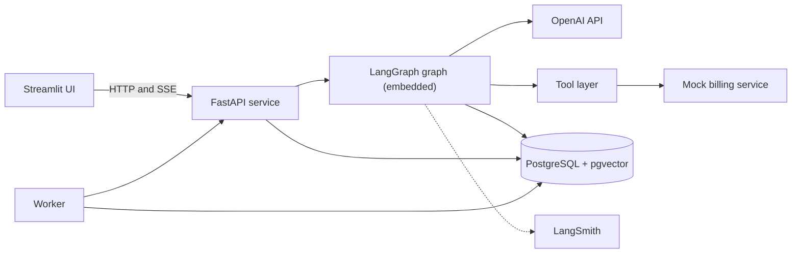
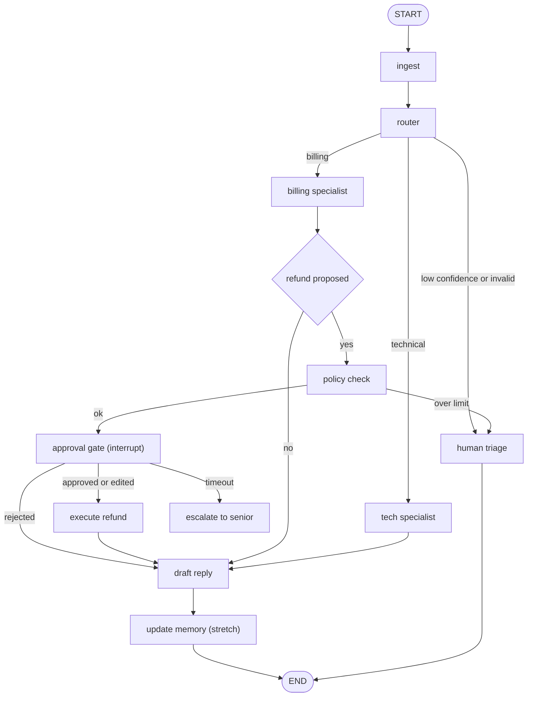

# Design Document: P1 Support Agent

## Overview

A customer-support triage and resolution agent. Streamlit is the UI, FastAPI hosts the LangGraph graph in-process, PostgreSQL (with pgvector) holds checkpoints, long-term memory and application data, and a worker enforces the 24-hour approval timeout. Everything runs locally under Docker Compose. LLM calls go to OpenAI (`gpt-4o-mini` default); runs are traced in LangSmith.

Requirement numbers below refer to [requirements.md](./requirements.md).

**Phasing**
- **MVP:** Requirements 1-6, 11, plus the Compose, auth, worker and migration parts of 12.
- **Stretch:** 7 (summarizer), 8-10 (memory), SSE streaming polish.

## Architecture



| Service | Role | Image/Tech |
|---|---|---|
| `ui` | Customer chat page, reviewer approval page, password login | Streamlit |
| `api` | REST + SSE, auth/session check, graph execution, policy engine | FastAPI, LangGraph, psycopg3 |
| `worker` | Escalates approvals pending > 24h; retries stuck runs | Python, same codebase as `api` |
| `postgres` | Checkpointer, Store (pgvector), app tables | `pgvector/pgvector` |
| `mock-billing` | Orders, refunds with idempotency keys | FastAPI |

All services share one codebase package `support_agent/` except `ui` and `mock-billing`.

## Repository layout

```
p1-support-agent/
  docker-compose.yml
  .env.example
  api/
    main.py                 # FastAPI app, routes, SSE
    auth.py                 # session lookup, role dependency
    config.py               # pydantic-settings (models, thresholds, limits)
    graph/
      state.py              # state schemas, reducers
      router.py             # intent node
      billing.py            # billing sub-graph
      tech.py               # tech sub-graph
      approval.py           # approval gate, refund execution
      memory.py             # profile/issues/instructions (stretch)
      summarize.py          # (stretch)
      build.py              # assemble graph, compile with checkpointer/store
    policy.py               # deterministic refund policy
    tools/                  # typed tools (orders, refunds, kb_search)
    db/                     # SQLAlchemy models, Alembic migrations
    redact.py               # PII redaction for traces/logs
  worker/main.py            # approval-timeout loop
  mock_billing/main.py
  ui/app.py, ui/pages/
  evals/
    dataset.jsonl           # synthetic labeled tickets
    baseline.py             # keyword + RAG baseline
    run_evals.py
  tests/
```

## Graph design



### State (Requirement 2)

Three schemas using `StateGraph(OverallState, input=InputState, output=OutputState)`.

```python
class InputState(TypedDict):
    ticket_id: str
    customer_id: str          # set by API from session, never from the client body
    text: str

class OutputState(TypedDict):
    messages: Annotated[list[AnyMessage], add_messages]
    status: Literal["replied","pending_approval","escalated","triage"]

class OverallState(InputState, OutputState):
    intent: Intent | None
    refund: RefundAction | None
    actions_taken: Annotated[list[Action], merge_actions]   # append + dedupe by action_id
    summary: str                                           # stretch
    scratch: dict                                          # private, never in OutputState
    step_count: int
    token_spend: int
```

`merge_actions` concatenates and dedupes by `action_id`, so parallel branches keep both entries.

### Pydantic models

```python
class Intent(BaseModel):
    label: Literal["billing","technical","other"]
    confidence: float = Field(ge=0, le=1)

class RefundAction(BaseModel):
    action_id: str              # idempotency key: f"{ticket_id}:{order_id}"
    order_id: str
    amount: Decimal = Field(gt=0)
    reason: str

class ReplyDraft(BaseModel):
    text: str
    citations: list[str] = Field(min_length=1)
```

### Nodes

| Node | Behavior | Requirement |
|---|---|---|
| `ingest` | Redact PII for trace metadata; set `thread_id=ticket_id` via config; init counters | 1.1, 6.5 |
| `router` | `llm.with_structured_output(Intent)`; one retry on validation error; threshold from config | 1.2-1.6 |
| `billing` | Tool loop (`get_order`, `get_billing_history`, `propose_refund`) with only those tools bound; tool errors retried with backoff then escalate | 3.1, 3.4, 6.2 |
| `tech` | `kb_search` (pgvector) then draft with citations | 3.2, 3.3 |
| `policy check` | `policy.py`: amount <= `MAX_REFUND` ($100), order belongs to customer, refund not already issued. Pure code, no LLM | 4.8 |
| `approval gate` | Graph compiled with `interrupt_before=["execute_refund"]`; state is persisted; resumed by API | 4.1-4.5 |
| `execute refund` | Calls mock billing with `Idempotency-Key = action_id`; appends to `actions_taken` | 4.7 |
| `draft` | Structured `ReplyDraft`; refuses if no citations | 3.3 |
| `human triage` | Writes triage record; sets status; no customer reply | 1.4, 1.5 |

Step and token limits: a conditional edge after each node checks `step_count`, `token_spend` against `MAX_STEPS` and `TOKEN_BUDGET`; exceeding routes to `human triage` (3.5, NFR-1). `recursion_limit` is also set in the run config as a hard stop.

### Approval flow (Requirement 4)

1. Graph pauses before `execute_refund`; API stores an `approvals` row (`pending`, `created_at`, `thread_id`, proposed values).
2. Reviewer page lists pending approvals and calls `POST /approvals/{id}/decision`.
3. API verifies the reviewer role, then:
   - **approve:** `graph.ainvoke(None, config)` resumes.
   - **edit:** `graph.aupdate_state(config, {"refund": edited})` (policy check re-runs on the edited value), then resume.
   - **reject:** `aupdate_state` sets `refund=None` and `status` flag, resume continues to `draft`.
4. Decision, reviewer identity, timestamp, original and final values are written to `audit_log`.
5. Worker finds `pending` approvals older than 24h, marks `escalated`, and notifies the senior queue. It never approves.

Because the pause is a checkpoint in Postgres, a restart does not lose it (5.3).

### Concurrency (Requirement 12.3-12.4)

A per-thread lock (Postgres advisory lock keyed on `thread_id`) serializes runs. A second message on an active thread is queued (`enqueue`) and processed after the first finishes. A thread that has an executed refund in `actions_taken` is never cancelled.

## Memory design (stretch, Requirements 8-10)

| Memory | Namespace | Shape | Write path |
|---|---|---|---|
| Profile | `(customer_id, "profile")` | one `CustomerProfile` doc | Trustcall `create_extractor(..., enable_inserts=False)` with the existing doc passed in, so it patches |
| Issues | `(customer_id, "issues")` | many `IssueRecord` docs, embedded | Trustcall with `enable_inserts=True`; dedupe by (order_id, cause) |
| Instructions | `(team_id, "instructions")` | one text doc | LLM proposes edit from reviewer change; applied only after lead confirms |

Safeguards:
- Memory writes take input only from customer and reviewer messages, never tool or document text (8.5).
- Namespaces are built server-side from the session; no endpoint accepts a namespace (8.6).
- Contradictions: newer value wins; previous value appended to `history` with timestamp (8.4).
- Issues carry `outcome` ("worked", "failed"); the retrieval step filters out failed fixes (9.3). Records older than retention are deleted by the worker (9.5).
- View/edit/delete endpoints under `/me/memory` (8.7).

Store index: `AsyncPostgresStore` with `index={"dims":1536,"embed":"openai:text-embedding-3-small"}`.

## Summarization (stretch, Requirement 7)

`summarize` node runs when `len(messages) > MAX_MESSAGES`: summarizes older messages with the draft model into `summary`, then returns `RemoveMessage` for each summarized id, keeping the last `KEEP_LAST`. A `filter_tool_output` helper truncates bulky tool results before they reach the model.

## Data model (application tables, Alembic)

| Table | Key columns |
|---|---|
| `users` | id, username, password_hash, role (`customer`/`reviewer`/`senior`), customer_id, team_id |
| `tickets` | id, customer_id, status, created_at |
| `approvals` | id, ticket_id, thread_id, proposed (jsonb), final (jsonb), status, reviewer_id, created_at, decided_at |
| `triage_queue` | id, ticket_id, reason, created_at |
| `audit_log` | id, ts, actor, event, thread_id, before (jsonb), after (jsonb) (insert-only) |
| `eval_runs` / `eval_results` | run_id, system (`agent`/`baseline`), metric, value |
| `kb_articles` | id, title, body, embedding (vector) |

LangGraph creates its own checkpoint and store tables via `setup()`. The audit table has no UPDATE/DELETE grants for the app role.

## API

| Endpoint | Role | Purpose |
|---|---|---|
| `POST /login` | any | Verifies password, returns session id (set in Streamlit session) |
| `POST /tickets` | customer | Submit ticket; returns `ticket_id` |
| `POST /tickets/{id}/messages` | customer | Follow-up message; SSE stream of progress and reply |
| `GET /tickets/{id}` | customer | Status and message history |
| `GET /approvals?status=pending` | reviewer | List pending approvals |
| `POST /approvals/{id}/decision` | reviewer | approve / edit / reject |
| `GET /threads/{id}/history` | reviewer | Checkpoint history (5.4) |
| `GET/PUT/DELETE /me/memory` | customer | Memory control (stretch) |
| `GET /health` | none | Liveness |

Identity (`customer_id`, `team_id`, role) comes from the session via a FastAPI dependency. Request bodies never contain them. Phase 1 auth is a seeded users table with hashed passwords (argon2/bcrypt) and a server-side session id; this is isolated behind `auth.py` so SSO can replace it later.

## Security and guardrails (Requirement 6)

- Ticket text, KB content and tool outputs are inserted into prompts inside delimited, labeled blocks with an instruction to treat them as data. This reduces but does not eliminate injection, so the real controls are structural:
  - each specialist binds only its own tools (6.2)
  - tool arguments are Pydantic-validated, and `customer_id` is injected by code, not chosen by the model (6.3)
  - the refund path ends at the Policy_Engine and the Approval_Gate, which the model cannot bypass (4.8, 6.4)
- `redact.py` masks email, phone, and card-like numbers; applied to LangSmith inputs/outputs through a `hide_inputs`/`hide_outputs` hook and to application logs (6.5).
- Secrets (OpenAI key, LangSmith key, DB password) come from environment variables via `.env`, never graph state or the repo (6.6).

## Error handling and reliability

| Failure | Handling |
|---|---|
| Router output invalid | One retry, then triage |
| Tool/API error | Exponential backoff, max 3 tries, then triage with reason |
| OpenAI rate limit/timeouts | Client retries; on exhaustion, run fails to triage |
| Process restart | State resumes from the Postgres checkpoint |
| Duplicate refund attempt | Idempotency key at mock billing returns the original result |
| Worker crash | Stateless loop; picks up on restart |

## Evaluation design (Requirement 11)

- **Dataset:** `evals/dataset.jsonl`, generated with an LLM then reviewed by hand. Fields: ticket text, customer fixture, expected intent, expected refund (yes/no and amount), expected citations, tags (`injection`, `over_limit`, `ambiguous`). Start at 20 tickets, grow to 200.
- **Baseline:** `baseline.py` with keyword routing and a single RAG answer over the same KB.
- **Runner:** `run_evals.py` runs agent and baseline over the dataset, with the approval gate auto-answered by a scripted reviewer (approve in-policy, reject others), and writes `eval_results`.
- **Metrics:** routing accuracy; resolution correctness (LLM judge against expected answer, with a human-checked sample); unapproved-action count (any refund executed without a recorded approval; must be 0); cost per ticket (tokens x price); escalation rate.
- **Regression:** thresholds stored in `evals/thresholds.json`; `run_evals.py --check` exits non-zero on any miss, used in CI.
- **Tracing:** each run uses `metadata={"thread_id", "ticket_id"}` and a LangSmith project per environment.

## Testing strategy

- **Unit:** each node with a fake chat model and fake tools; reducer tests (`merge_actions` with parallel writes); policy tests (limits, ownership).
- **Integration:** compose-based tests against a real Postgres: pause at approval, restart the `api` container, resume, and assert a single refund.
- **Security tests:** injection tickets must produce no out-of-scope tool calls; cross-customer memory/ticket access returns 403/404.
- **Property check:** repeated resume of the same approval never creates a second refund.

## Docker Compose

```yaml
services:
  postgres:  { image: pgvector/pgvector:pg16, volumes: [pgdata:/var/lib/postgresql/data] }
  mock-billing: { build: ./mock_billing }
  api:       { build: ./api, env_file: .env, depends_on: [postgres, mock-billing], ports: ["8000:8000"] }
  worker:    { build: ./api, command: python -m worker.main, env_file: .env, depends_on: [postgres] }
  ui:        { build: ./ui, environment: [API_URL=http://api:8000], depends_on: [api], ports: ["8501:8501"] }
volumes: { pgdata: {} }
```

`.env.example` lists `OPENAI_API_KEY`, `LANGSMITH_API_KEY`, `LANGSMITH_TRACING`, `DATABASE_URL`, `ROUTER_MODEL`, `DRAFT_MODEL`, `CONFIDENCE_THRESHOLD`, `MAX_REFUND=100`, `APPROVAL_TIMEOUT_HOURS=24`, `MAX_STEPS`, `TOKEN_BUDGET`. A different Compose project name and ports let several course projects run side by side locally.

## Requirement traceability

| Requirement | Design section |
|---|---|
| 1 Routing | router node, `Intent`, config threshold |
| 2 State | State schemas, `merge_actions` |
| 3 Specialists | billing/tech nodes, tool layer, limits |
| 4 Refund HITL | policy check, approval gate, worker, audit log |
| 5 Durability | Postgres checkpointer, history endpoint |
| 6 Safety | Security section, `redact.py` |
| 7 Summarize | Summarization section |
| 8-10 Memory | Memory design |
| 11 Evals | Evaluation design |
| 12 Service | Architecture, API, Compose, concurrency |

## Risks and open items

- **Per-thread lock with in-process graph:** advisory locks protect against concurrent runs across replicas, but streaming responses hold a DB connection; size the pool accordingly.
- **Streamlit reruns:** keep only `ticket_id` and session id in `st.session_state`; fetch history from the API.
- **LLM judge bias:** use a different model or rubric for judging than for drafting, and hand-check a sample.
- **Trustcall on `gpt-4o-mini`:** verify patch quality in tests before relying on it; fall back to a stronger model for memory writes if needed.
