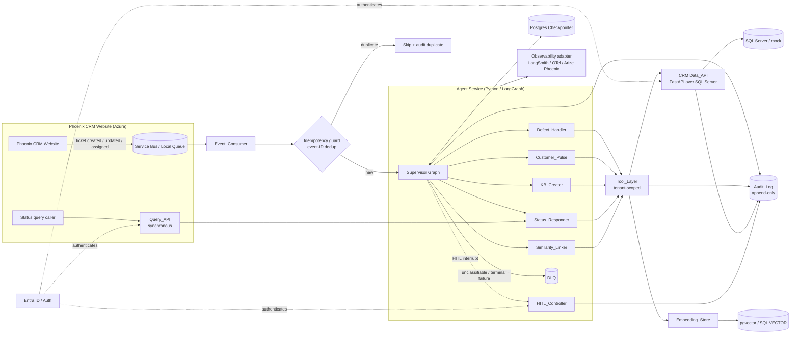

# Design Document

## Overview

Phoenix CRM Agents (`phoenix-crm-agents`) is an event-driven, agentic AI backbone built in Python on LangGraph. It reacts to ticket lifecycle events published by the Phoenix CRM website and performs intelligent background actions across five capabilities: defect handling, customer pulse summaries, knowledge-base (KB) article creation, ticket status lookup, and similarity linking. A supervisor graph classifies each inbound event and routes it to a specialist sub-graph. Capability 1 (defect handling) is designed as the first full end-to-end vertical slice; capabilities 2–5 are designed with capability-complete interfaces and scaffolded sub-graphs.

The design is governed by two overriding constraints that shape nearly every component:

1. **Multi-tenant safety.** The system processes customer data for many agencies. Four enterprise concerns are non-negotiable for V1 and are designed concretely here: tenant isolation and authorization (Req 13), prompt-injection and output guardrails (Req 14), idempotency with a dead-letter queue (Req 15), and an immutable audit trail (Req 16).
2. **Local-to-Azure config-swap.** Every external dependency sits behind an interface — `Event_Consumer`, `LLM_Provider`, `Embedding_Store`, the observability adapter, and the `Data_API` client — so moving from the local Docker stack to Azure is a configuration change, not a rewrite (Req 22, 23).

This document specifies both the high-level architecture (component responsibilities, interfaces, workflows) and the low-level design (data models, scoping enforcement, retry math, PII redaction, audit semantics) needed to satisfy all 23 requirements.

> **Naming note.** The product is "Phoenix CRM" and this service is `phoenix-crm-agents`. The optional tracer "Arize Phoenix" is an unrelated third-party tool. Throughout this document, "Phoenix" alone means the product; the tracer is always written in full as "Arize Phoenix".

### Research findings informing the design

- **LangGraph durable execution.** LangGraph persists each run via a checkpointer keyed by `thread_id`, enabling pause/resume, memory, and human-in-the-loop interrupts (`interrupt()` / `Command(resume=...)`). The production-grade option is `langgraph-checkpoint-postgres` (`AsyncPostgresSaver`). This directly supports Req 2 (durable/resumable runs) and Req 7 (HITL approval). Source: [LangGraph persistence docs](https://langchain-ai.github.io/langgraph/concepts/persistence/).
- **Supervisor pattern.** A supervisor node with conditional edges (or the prebuilt `langgraph-supervisor`) routes events to specialist compiled sub-graphs, keeping each capability independently testable and satisfying the extensibility requirement (Req 12). Source: [LangGraph multi-agent concepts](https://langchain-ai.github.io/langgraph/concepts/multi_agent/).
- **SQL Server native vectors (verified).** SQL Server 2025 (17.x) and Azure SQL provide a `VECTOR(n)` type and vector search functions, letting embeddings sit next to CRM data in Azure. Source: [Microsoft Learn — vector data type](https://learn.microsoft.com/en-us/sql/t-sql/data-types/vector-data-type).
- **pgvector alternative.** Postgres is already in the stack for checkpointing, so `pgvector` adds vector search with no extra local infrastructure — the local default behind the `Embedding_Store` interface (Req 21).
- **Azure OpenAI integration.** `langchain-openai` provides `AzureChatOpenAI` and `AzureOpenAIEmbeddings` for chat and embeddings; a thin provider factory keeps the LLM pluggable (Req 4).
- **Local event source.** A Postgres/Redis-backed queue (or the Azure Service Bus emulator) behind an `Event_Consumer` interface lets production swap to Azure Service Bus without touching agent code (Req 22, 23).

## Architecture

### System context



### Layered architecture

The system is organized into layers, each depending only on the layer(s) below and on interfaces (not concrete implementations):

| Layer | Components | Responsibility |
|---|---|---|
| Ingestion | `Event_Consumer`, idempotency guard, DLQ | Consume events at-least-once, dedup, route failures |
| Orchestration | `Supervisor`, specialist sub-graphs, `Checkpointer`, `HITL_Controller` | Classify, route, run graphs, persist state, pause for approval |
| Capability | `Defect_Handler`, `Customer_Pulse`, `KB_Creator`, `Status_Responder`, `Similarity_Linker` | Capability-specific logic |
| Tool | `Tool_Layer` | Typed, tenant-scoped tools wrapping Data_API + Embedding_Store; guardrails |
| Provider | `Data_API` client, `LLM_Provider`, `Embedding_Store`, observability adapter | Pluggable external access |
| Service surface | `Data_API` (FastAPI), `Query_API`, `HITL_Controller` | Authenticated HTTP entry points |
| Platform | `Checkpointer` (Postgres), `Audit_Log`, secret store, config | Cross-cutting infrastructure |

### Cross-cutting enforcement points

Three security invariants are enforced at architecturally fixed choke points so no capability code can bypass them:

- **Tenant_Context derivation** happens once, at the authenticated service boundary (`Data_API`, `Query_API`, `HITL_Controller`) or at event admission, before any Data_API operation (Req 13.1). It is carried immutably through run state.
- **Agency-ID injection** happens inside the `Tool_Layer` and is re-validated inside the `Data_API`, so even a compromised prompt cannot widen scope (Req 13.3–13.5, Req 14.4).
- **Audit writes** are performed by the component executing an auditable action, with a write-before-complete contract (Req 16.5): if the audit write fails, the action is not treated as complete.

### Technology choices and rationale

| Decision | Choice | Rationale | Requirements |
|---|---|---|---|
| Runtime | Python + LangGraph | Native durable execution, interrupts, supervisor pattern | 1, 2, 7, 12 |
| Checkpointer | `AsyncPostgresSaver` | Production-grade durable state keyed by `thread_id` | 2 |
| Data access | FastAPI `Data_API` over SQL Server | Single controlled gateway; agents never touch SQL | 3, 13 |
| LLM | Azure OpenAI behind `LLM_Provider` | Pluggable for local/test | 4, 23 |
| Vectors | pgvector (local) / SQL VECTOR (Azure) behind `Embedding_Store` | Config swap, embeddings colocated in Azure | 21, 23 |
| Events | Local queue / Azure Service Bus behind `Event_Consumer` | Config swap, at-least-once | 1, 22, 23 |
| Observability | LangSmith / OTel / Arize Phoenix behind adapter | Env-selected backend | 20 |
| Autonomy | Recommend-only, feature-flagged toward tiered autonomy | Human controls customer-facing effects first | 6, 7, 11 |

## Components and Interfaces

Interfaces below are expressed as Python protocol/abstract signatures. Concrete implementations are selected from environment-driven configuration (Req 4, 20, 21, 23).

### Event_Consumer

Consumes ticket events and submits them to the supervisor without blocking the publisher (Req 1.1, 1.6). Local-queue and Azure Service Bus implementations share one interface (Req 22.3, 23.1).

```python
class EventConsumer(Protocol):
    async def start(self, handler: Callable[[TicketEvent], Awaitable[ProcessResult]]) -> None: ...
    async def ack(self, event: TicketEvent) -> None: ...
    async def nack(self, event: TicketEvent, retry_after: float) -> None: ...
    async def dead_letter(self, event: TicketEvent, failure: FailureMetadata) -> None: ...
```

The consumer wraps the supervisor invocation with the **idempotency guard** and the **retry/backoff + DLQ policy** (Req 15). It derives the `Tenant_Context` for an event from the authenticated event envelope (events published by the website carry the authenticated agency), never from the ticket body (Req 13.1, 13.4).

### Supervisor

Classifies each event into exactly one capability category and routes to the matching specialist sub-graph (Req 1.2, 1.3). Unclassifiable events go to the DLQ with a classification-failure reason (Req 1.4). On entry it writes the run state to the checkpointer keyed by a `thread_id` derived from the event (Req 1.5).

```python
class Supervisor:
    def classify(self, event: TicketEvent) -> CapabilityCategory | None: ...
    async def route(self, event: TicketEvent, ctx: TenantContext) -> RunOutcome: ...
    def register(self, category: CapabilityCategory, graph: CompiledGraph) -> None: ...  # Req 12.1
```

Registration is dynamic: adding a specialist is `register(category, graph)` plus a classifier rule, with no change to existing specialists (Req 12.1, 12.3). All specialists reuse the same `Tool_Layer`, `Checkpointer`, and `Embedding_Store` (Req 12.2).

`thread_id` is derived deterministically as `f"{category}:{agency_id}:{ticket_id}:{event_id}"`, which also gives per-ticket run isolation.

### Specialist sub-graphs

Each specialist is an independently compiled LangGraph with its own typed state schema. All receive an immutable `TenantContext` and an iteration cap (Req 19.1).

- **Defect_Handler (full):** ingest → embed → vector search → fetch fixes → analyze/rank → propose (grounded) → draft write-back → HITL interrupt. Detailed in Workflows.
- **Customer_Pulse:** list agency open items via Data_API → summarize (Req 8).
- **KB_Creator:** on "assigned back to customer" events, evaluate warrant → search existing KB → create draft with citations unless an equivalent exists (Req 9).
- **Status_Responder:** invoked synchronously by `Query_API`; retrieves ticket and returns a status summary (Req 10).
- **Similarity_Linker:** vector search for similar tickets → link above threshold, as a draft in recommend-only mode (Req 11).

### Tool_Layer

Typed LangChain tools wrapping the `Data_API` client and `Embedding_Store`. This is the guardrail enforcement layer.

```python
class ToolLayer:
    def __init__(self, ctx: TenantContext, allowlist: frozenset[str], data_api: DataApiClient,
                 embeddings: EmbeddingStore, audit: AuditLog): ...

    async def call(self, tool_name: str, args: dict) -> ToolResult: ...
```

Responsibilities:
- Validate every tool input against the tool's schema before dispatch (Req 3.4).
- Return a structured error result on Data_API error — never raise an unhandled exception into the graph (Req 3.5).
- **Inject** `ctx.agency_id` into every outbound Data_API/Embedding_Store call; strip and ignore any agency identifier appearing in `args` that originated from model/retrieved content, and record the binding decision in the audit log (Req 13.3, 13.4, 14.4).
- Enforce the **tool allow-list**: refuse any `tool_name` not in `allowlist`, leaving tenant data unchanged, returning a "not permitted" error, and recording the refusal (Req 14.2, 14.3, 14.5).
- Available read tools: `get_ticket`, `list_agency_open_items`, `search_defects`, `get_recent_fixes`, `search_kb` (Req 3.2). Write tools: `write_recommendation`, `create_kb_draft`, `link_tickets` (Req 3.3).

### Data_API

FastAPI service over SQL Server; the sole gateway to CRM data (Req 3.1). Authenticates every request (Req 17.1). Enforces record-level tenant scoping on every read and write: each operation accesses only records whose agency identifier equals the `Tenant_Context` agency (Req 13.5). A cross-agency attempt is denied with no data change and an unauthorized response, and the denial is audited (Req 13.6, 13.7). A mock implementation seeded with sample tickets, defects, fixes, and KB articles backs local development (Req 3.6).

```
GET  /tickets/{id}
GET  /agencies/{id}/open-items
POST /defects/search
GET  /defects/{id}/recent-fixes
POST /kb/search
POST /tickets/{id}/recommendations        # write Recommendation_Draft
POST /kb/drafts                            # create KB draft
POST /tickets/{id}/links                   # link tickets
```

Every endpoint receives the agency identifier from the authenticated context and uses it as a mandatory filter/column — the agency is never read from the request body.

### LLM_Provider

Single interface for all chat and embedding operations (Req 4.1). Azure OpenAI (`AzureChatOpenAI`, `AzureOpenAIEmbeddings`) is the default; local/alternative providers plug in for tests (Req 4.2, 4.3). Selected from env config (Req 4.4, 23.2). Applies rate-limit retry with exponential backoff (Req 19.4) and serves cached embeddings when available (Req 19.5).

```python
class LLMProvider(Protocol):
    async def chat(self, messages: list[Message], *, max_tokens: int | None = None) -> ChatResult: ...
    async def embed(self, texts: list[str]) -> list[Vector]: ...
```

### Embedding_Store

Vector storage behind one interface for all upsert/search operations (Req 21.1). pgvector (local default) and SQL Server native VECTOR (Azure) implementations are env-selected (Req 21.2, 21.3, 23.3). **Every search filters by the `Tenant_Context` agency** (Req 21.4, and the scoping basis for Req 5.6, 11.3).

```python
class EmbeddingStore(Protocol):
    async def upsert(self, items: list[EmbeddingRecord]) -> None: ...
    async def search(self, query: Vector, k: int, *, agency_id: AgencyId,
                      kind: Literal["defect", "ticket", "kb"]) -> list[SearchHit]: ...
```

`agency_id` is a required keyword, so a search cannot be issued without a scope.

### Checkpointer

`AsyncPostgresSaver` persisting run state keyed by `thread_id` (Req 2.1). Resuming with a known `thread_id` restores the most recent checkpoint (Req 2.2). Paused HITL runs retain state until a resume decision (Req 2.3), surviving restarts (Req 2.4).

### HITL_Controller

Authenticated control endpoint (Req 17.3) receiving approve/reject/edit decisions and resuming the paused run via `Command(resume=...)` (Req 7.2–7.4). Each decision is audited with actor, timestamp, agency, and ticket (Req 16.3).

```
POST /runs/{thread_id}/decision   # {decision: approve|reject|edit, edited_content?: str}
```

### Query_API

Synchronous REST endpoint for status lookups (Req 10.1, 10.4). Authenticates every request (Req 17.2). Invokes the `Status_Responder` directly (not through the queue), scoping retrieval to the tenant (Req 10.3) and returning not-found when the ticket does not exist within the tenant (Req 10.2).

```
GET /tickets/{id}/status
```

### Audit_Log

Append-only store recording every agent action: reads, proposals, human decisions, denials, refusals, and limit stops (Req 16.1–16.3, 13.7, 14.3, 19.2). Rejects any modify/delete of existing records (Req 16.4). Honors a write-before-complete contract: a failed audit write means the action is not complete and the failure is surfaced (Req 16.5). Query by ticket returns the action history ordered chronologically ascending (Req 16.6), or an empty result when none exist (Req 16.7).

```python
class AuditLog(Protocol):
    async def append(self, record: AuditRecord) -> None: ...        # raises on failure (Req 16.5)
    async def history(self, ticket_id: TicketId, ctx: TenantContext) -> list[AuditRecord]: ...  # asc
```

### Observability adapter

Emits trace spans for every run through the env-selected backend (Req 20.1, 20.4): LangSmith (development tracer, Req 20.2), OpenTelemetry (production exporter, Req 20.3), with Arize Phoenix optional. Spans are scrubbed of PII before export (Req 14.6).

### Secrets and configuration

In non-local environments, API keys, DB credentials, and LLM keys are read from a managed secret store (Azure Key Vault) (Req 18.1). Env files hold only local-dev config; production secrets are excluded (Req 18.2). A single `Settings` object (pydantic-settings) selects all pluggable implementations from the environment (Req 4.4, 20.4, 21, 23.3).

## Data Models

Models are expressed as Python dataclasses/pydantic models. Persisted CRM entities live in SQL Server behind the `Data_API`; platform entities (embeddings, audit, dedup, DLQ, checkpoints) live in Postgres locally.

### Tenant_Context

```python
@dataclass(frozen=True)
class TenantContext:
    agency_id: AgencyId        # derived from authenticated credentials only (Req 13.1)
    actor: str                 # authenticated principal (for audit)
    correlation_id: str
```

Immutable and carried in every run's state and every tool call. Never populated from model-generated or retrieved content (Req 13.4).

### CRM entities

```python
@dataclass
class Agency:
    agency_id: AgencyId
    name: str

@dataclass
class Ticket:
    ticket_id: TicketId
    agency_id: AgencyId          # scoping column (Req 13.5)
    type: Literal["defect", "enhancement", "interface_dev", "general"]
    title: str
    body: str                    # UNTRUSTED customer input (Req 14.1)
    status: str
    assigned_to: str | None
    created_at: datetime
    updated_at: datetime

@dataclass
class Defect:
    defect_id: DefectId
    ticket_id: TicketId
    agency_id: AgencyId
    summary: str
    details: str                 # UNTRUSTED

@dataclass
class Fix:
    fix_id: FixId
    defect_id: DefectId
    agency_id: AgencyId
    description: str
    applied_at: datetime

@dataclass
class Enhancement:
    enhancement_id: str
    ticket_id: TicketId
    agency_id: AgencyId
    status: Literal["pending", "in_progress", "done"]
    summary: str

@dataclass
class InterfaceDevItem:
    item_id: str
    ticket_id: TicketId
    agency_id: AgencyId
    status: Literal["open", "closed"]
    summary: str

@dataclass
class KBArticle:
    kb_id: str
    agency_id: AgencyId
    title: str
    content: str
    state: Literal["draft", "published"]
    citations: list[Citation]
```

Every CRM entity carries `agency_id`, which is the record-level scoping column enforced by the Data_API (Req 13.5).

### Recommendation_Draft

```python
@dataclass
class RecommendationDraft:
    draft_id: str
    ticket_id: TicketId
    agency_id: AgencyId
    kind: Literal["defect_solution", "ticket_link", "kb_article"]
    content: str
    citations: list[Citation]        # required for publication (Req 6.2, 6.3)
    state: Literal["pending_approval", "approved", "rejected"]  # Req 6.5, 7
    created_at: datetime
```

In recommend-only mode, drafts are created `pending_approval` and never applied directly (Req 6.5, 11.4).

```python
@dataclass
class Citation:
    source_kind: Literal["fix", "ticket", "kb"]
    source_id: str
    excerpt: str
```

### Embedding records

```python
@dataclass
class EmbeddingRecord:
    id: str
    agency_id: AgencyId          # mandatory search filter (Req 21.4)
    kind: Literal["defect", "ticket", "kb"]
    vector: Vector
    metadata: dict
```

### Idempotency (dedup) and DLQ records

```python
@dataclass
class DedupRecord:
    event_id: str                        # unique within the guard window
    first_seen_at: datetime
    completed_at: datetime | None        # set when processed to completion (Req 15.2)
    guard_window: timedelta = timedelta(hours=24)   # Req 15.1
    produced_artifact_id: str | None

@dataclass
class DLQRecord:
    event_id: str
    failure_reason: str
    attempts: int
    final_failure_at: datetime
# DLQ capacity default 10,000 (Req 15.5)
```

### Retry policy (value object)

```python
@dataclass(frozen=True)
class RetryPolicy:
    max_attempts: int = 5                # Req 15.3
    base_seconds: float = 1.0            # Req 15.3
    factor: float = 2.0
    max_interval_seconds: float = 60.0   # Req 15.3

    def backoff(self, attempt: int) -> float:   # attempt starts at 1
        return min(self.base_seconds * (self.factor ** (attempt - 1)), self.max_interval_seconds)
```

### Audit record

```python
@dataclass(frozen=True)
class AuditRecord:
    record_id: str
    action: Literal["read", "proposal", "decision", "denial", "refusal",
                    "binding", "limit_stop", "duplicate"]
    actor: str
    agency_id: AgencyId
    ticket_id: TicketId | None
    detail: dict                 # PII-redacted (Req 14.6)
    timestamp: datetime          # ordering key (Req 16.6)
```

Stored append-only; the store rejects updates and deletes (Req 16.4).

### Run state (per specialist)

```python
class DefectHandlerState(TypedDict):
    ctx: TenantContext
    ticket: Ticket
    defect_embedding: Vector
    candidates: list[SearchHit]
    ranked: list[RankedCandidate]
    proposal: RecommendationDraft | None
    iterations: int              # capped (Req 19.1)
    tokens_used: int             # tracked per run (Req 19.3)
```
