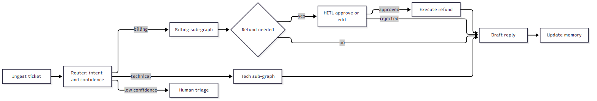
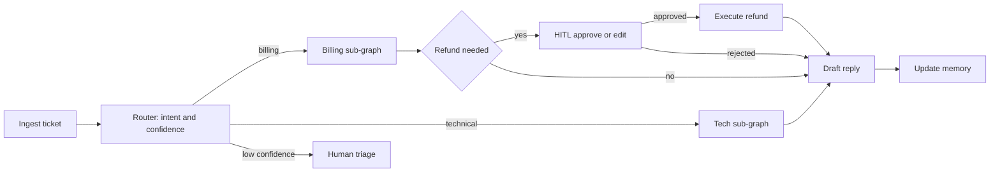
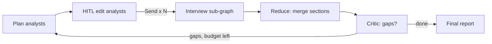
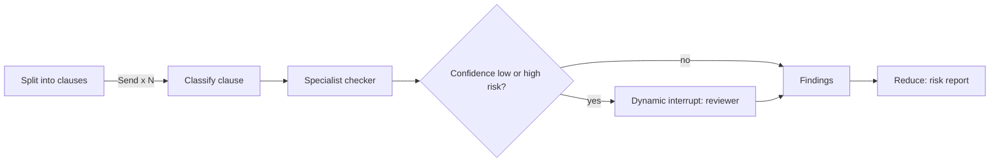
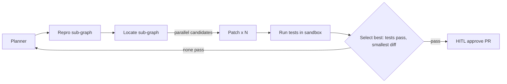

# Agentic System Projects

Five projects, each built to exercise a distinct agentic pattern from the LangGraph course (modules 0-6). Every capability listed must pass one test: **what fails without it?**

Course mapping: router (m1) · reducers, schemas, trim/summarize, checkpointer (m2) · breakpoints, HITL, time-travel (m3) · sub-graphs, `Send` map-reduce, parallelism (m4) · Store, profile/collection/instructions memory, Trustcall (m5) · deployment, assistants, double-texting (m6).

## Capability matrix

| Capability | P1 Support | P2 Research | P3 Contracts | P4 Eng. Copilot | P5 Platform |
|---|---|---|---|---|---|
| Router / orchestrator | ● router | | ● clause routing | ● orchestrator-worker | |
| State reducers | ● | ● | ● | ● | |
| Input/output/private schemas | ● | | ● | | |
| Trim / filter / summarizer | ● | ● | | ● | |
| Checkpointer + thread_id | ● | ● | ● | ● | ● |
| Long-term memory: profile | ● | | | ● | |
| Long-term memory: collection | ● | | ● | ● | |
| Long-term memory: instructions | ● | | ● | ● | |
| Trustcall | ● | | ● | | |
| Pydantic structured output | ● | ● | ● | ● | |
| Breakpoints / HITL | ● | ● | ● | ● | |
| Time-travel / fork | | | ● | ● | |
| Map-reduce (`Send`) | | ● | ● | | |
| Sub-graphs | | ● | | ● | |
| Reflection / critic loop | | ● | | ● | |
| RAG / retrieval | ● | ● | ● | ● | |
| Evals + tracing | ● | ● | ● | ● | ● |
| Deployment, assistants, double-texting | ● | | | | ● |

---

## P1. Customer-Support Triage & Resolution Agent
**Pattern:** router + memory + HITL.

**User story:** A support lead wants tickets answered correctly using the customer's history, with risky actions (refunds) approved by a human.
**Baseline to beat:** keyword routing + a single RAG chatbot with no memory. Target: higher first-contact resolution, fewer misroutes, zero unapproved refunds.
**Why an agent, not a pipeline:** the path varies (answer, look up order, escalate, refund) and needs a pause for approval mid-run.

**Graph**

Mermaid source

**State:** `messages` (`add_messages`), `intent`, `confidence`, `actions_taken` (append reducer, deduped by action id), `summary`, private `scratch`.

| Capability | How | Why (failure without it) |
|---|---|---|
| Router with Pydantic output | LLM returns `Intent{label, confidence}`; below threshold goes to a human | Misroutes silently produce wrong answers |
| Reducers | `actions_taken` append + dedupe | Parallel branches overwrite each other; duplicate refunds |
| Input/output/private schemas | API sees only `messages`; scratch stays private | Leaks internal reasoning/PII |
| Trim + summarizer | Summarize after N turns, `RemoveMessage` old ones | Token cost and lost-in-the-middle on long tickets |
| Checkpointer + `thread_id`=ticket id | Postgres saver | Ticket can't resume after restart or reassignment |
| Profile memory (Store, `(user_id,"profile")`) + Trustcall | Plan, device, preferred tone; patch updates | Full rewrites drop existing facts |
| Collection memory | Past issues, semantic search | Agent repeats failed fixes |
| Instructions memory | Support-lead feedback refines reply style | Style corrections never persist |
| HITL (`interrupt_before` refund tool) | Reviewer approves, edits amount, or rejects | Financial risk |
| Double-texting (`enqueue`/`rollback`) | Impatient follow-up messages | Race conditions on one thread |

**MVP:** router + two specialists + refund approval + checkpointer. **Stretch:** profile/collection memory, summarizer, deployment.
**Failure modes / guardrails:** low-confidence route, refund tool failure (retry once, then escalate), reviewer timeout (auto-escalate, never auto-approve), prompt injection in ticket text (tool outputs treated as untrusted; refund amount capped by policy outside the LLM).
**Evals:** 200 labeled historical tickets; metrics: routing accuracy, resolution correctness (LLM judge + human sample), unapproved-action count (must be 0), cost per ticket. **Data/tools:** public support datasets or synthetic; mock ticketing and billing APIs.

---

## P2. Deep Research Assistant (Analyst Panel)
**Pattern:** map-reduce + sub-graphs + critic loop.

**User story:** A researcher asks a broad question and gets a cited report from several perspectives.
**Baseline:** one LLM + one search pass. Target: higher citation coverage and factual accuracy at acceptable cost.
**Why an agent:** the number of sub-questions is dynamic, and a critic loop decides whether more research is needed.

**State:** `analysts` (list), `sections` (`operator.add`), `citations` (merge-by-URL reducer), `iteration`, `budget_tokens`.

| Capability | How | Why |
|---|---|---|
| `Send` map-reduce | One interview sub-graph per analyst, results reduced | Sequential runs are slow; N is only known at runtime |
| Sub-graphs with private state | Interview has its own messages/context | Parent state would bloat and collide |
| Parallel retrieval | Web + wiki + internal docs at once | Latency |
| Reducers | Append sections; dedupe citations | Safe concurrent writes |
| HITL breakpoint + `update_state` | Human edits the analyst list before fan-out | Wrong personas waste the most expensive step |
| Critic/reflection loop | Judge coverage; cap iterations | Shallow reports; cap prevents infinite loops |
| Pydantic | `Analyst`, `SearchQuery`, `Section` | Parseable intermediate results |
| Checkpointer + streaming | Resume long runs; stream progress | Runs take minutes |

**MVP:** 3 analysts, one retrieval source, reduce to report. **Stretch:** critic loop, budget enforcement, internal-docs RAG.
**Guardrails:** max iterations, token/cost budget in state, source allow-list, drop uncited claims. **Evals:** 30 questions with reference answers; metrics: claim-citation match rate, coverage, cost per report, vs. single-pass baseline.

---

## P3. Contract & Compliance Review Agent
**Pattern:** structured extraction + map-reduce + HITL (includes the healthcare/regulated variant).

**User story:** Legal ops needs risky clauses flagged in long contracts, with an auditable trail.
**Baseline:** manual review or one long-context prompt. Target: recall of high-risk clauses ≥ the manual baseline at lower review time.
**Why an agent:** clauses vary, uncertain ones need a human, and every step must be replayable.

| Capability | How | Why |
|---|---|---|
| Map-reduce | Per-clause analysis, merged report | Context limits; parallel speed |
| Router | Clause type to liability/IP/privacy checker | Specialist prompts outperform one generic prompt |
| Pydantic + Trustcall | `Clause`, `Risk`, `Obligation` schemas; patch as the reviewer corrects | Validated, incremental, no lost fields |
| Dynamic breakpoint (`NodeInterrupt`) | Raised when confidence below threshold | Humans only see what needs them |
| Time-travel / fork | Replay a review from any checkpoint with a changed playbook | Audit and "what if" analysis |
| Collection memory | Playbook and prior decisions (versioned) | Consistency across contracts |
| Instructions memory | Evolving review policy, reviewer-approved only | Policy drift control |
| Private schema | Redacted text goes to LLM; raw stays in private state | PII exposure |

**Security/regulatory:** define scope (GDPR/HIPAA if PHI), encryption at rest, retention and deletion, redact PII in traces, per-tenant namespaces, immutable audit log. **Memory risk:** only reviewer-confirmed items enter the playbook (prevents poisoning by contract text).
**Evals:** annotated contracts (e.g., CUAD dataset); metrics: clause recall/precision, high-risk recall, reviewer minutes per contract.
**Healthcare variant:** swap Clause for Patient profile and episodes; same private-schema and sign-off pattern.

---

## P4. Engineering Copilot (Bug Triage → Proposed Fix)
**Pattern:** orchestrator-worker + sub-graphs + sandboxed tools.

**User story:** A maintainer gets a reproduced bug and a tested patch proposal, never an unreviewed merge.
**Baseline:** single-prompt patch generation. Target: higher fraction of patches passing tests.
**Why an agent:** it needs a plan-execute-observe loop with replanning on failed tests.

| Capability | How | Why |
|---|---|---|
| Orchestrator-worker | Planner assigns repro/locate/patch | Distinct skills and tools per step |
| Parallel candidates + reducer | Select by test pass, then smallest diff | "Best" needs an objective criterion |
| Sub-graphs | Own state per stage | Isolation of logs and scratch |
| Summarizer/filter | Trim test logs and tool output | Logs blow up the context |
| HITL + time-travel | Approve PR, or fork from a checkpoint with edited plan | Destructive/side-effect actions |
| Memory | Repo conventions (instructions), past fixes (collection), maintainer profile | Fixes match house style |

**Guardrails:** sandboxed execution, read-only by default, allow-listed commands, idempotent PR creation, max replans. Treat issue text as untrusted input. **Evals:** SWE-bench-lite subset or seeded bugs; metrics: pass rate, cost, replans per fix.

---

## P5. Multi-Tenant Agent Platform (infra capstone)
**Pattern:** deployment, configuration, operations. Start its design early; it shapes P1-P4.

| Concern | Approach |
|---|---|
| Serving | LangGraph Server + Studio, SDK client, streaming modes |
| Tenancy | Assistants per tenant (`configurable`: model, prompts), namespaced Store, Postgres checkpointer |
| Concurrency | Double-texting strategy chosen per use case |
| Auth | Per-tenant auth; namespace enforced server-side, never client-supplied |
| Reliability | Retry/fallback models, recursion limit, cost budgets, timeouts |
| State evolution | Versioned schemas and a checkpoint-migration plan |
| Observability | LangSmith tracing, PII redaction, dashboards, cost per tenant |
| Quality | Eval suite in CI; replay recorded checkpoints as regression tests |

---

## Cross-cutting requirements (apply to every project)

**Evaluation:** a labeled dataset, an offline baseline comparison, regression runs in CI, trace review, and online monitoring. Include memory-quality checks: profile drift, wrong facts, duplicate items.

**Memory governance:** conflict resolution (newest-wins vs. confirm), expiry/forgetting, user view/edit/delete, schema validation on every Trustcall write, writes only from trusted sources (no raw tool or document text), namespace isolation tests.

**Safety:** prompt-injection handling for tool outputs and documents, least-privilege tool scopes, side-effect idempotency keys, output validation, secrets outside state.

**HITL design:** every interrupt defines approve / edit / reject paths, a timeout and escalation (never auto-approve), and a reviewer UI.

**Reliability:** error edges in the graph, tool retries with backoff, loop/recursion caps, token and cost budgets, model fallback, resume-after-crash tests.

**Other patterns to consider:** reflection/critic loops, replanning, RAG as an explicit retrieval node, guardrail nodes, structured-output retries, multi-agent handoffs, MCP tool servers, streaming UX.

## Build order and rationale
1. **P5 skeleton first** (Postgres checkpointer/store, tracing, eval harness): everything else depends on it.
2. **P1** (router, reducers, checkpointer, HITL, memory).
3. **P2** (map-reduce, sub-graphs).
4. **P3** (structured extraction, dynamic interrupts, time-travel).
5. **P4** (orchestrator-worker, sandboxing).
6. Finish **P5** (multi-tenant deployment, CI evals).

## Folded-in earlier ideas
- Executive assistant: variant of P1 (profile + todo collection + instructions memory; see module-5 `task_mAIstro`).
- Healthcare intake: variant of P3 (see above).
- NL→SQL analyst: variant of P2/P4; only worthwhile if query path is dynamic, otherwise use a plain pipeline with a read-only SQL guard and approval step.
