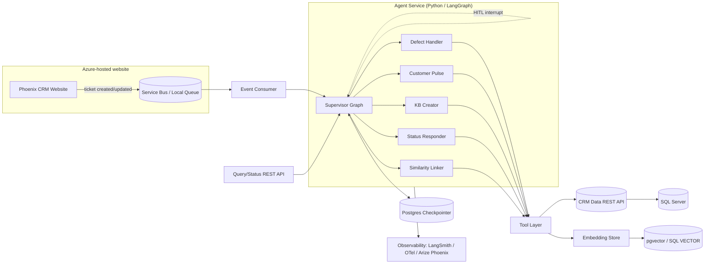
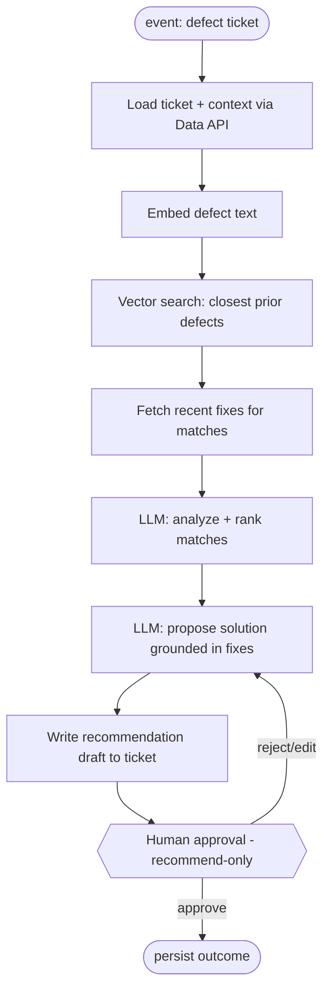

# Implementation Plan - Phoenix CRM Agentic AI Backbone (LangGraph)

## Problem Statement

Phoenix is a CRM/ticketing product used by agency admins (external customers) and internal members. Tickets are created in an Azure-hosted website backed by SQL Server. We need an agentic AI backbone that runs in the background, reacts to ticket lifecycle events, and performs intelligent actions:

1. Defect handling - analyze a defect, find the closest matching prior defects, propose solutions grounded in recent fixes
2. Customer pulse - summarize all open defects, pending enhancements, and open interface developments for an agency
3. KB creation - when a ticket is assigned back to the customer, draft a KB article if the info warrants one and no equivalent KB exists
4. Status lookup - answer "what's the status of ticket X" via a query API (Teams later)
5. Similarity linking - link related/duplicate tickets based on semantic similarity
6. Extensible for additional agentic behaviours

Scope for this plan: build the platform + capability 1 (defect handling) as a full end-to-end vertical slice, scaffold capabilities 2-5 as follow-on tasks, run locally in Docker, with an Azure-ready design.

## Requirements (from gathering)

| Decision | Choice |
|---|---|
| Language/runtime | Python (LangGraph native SDK) |
| Trigger model | Event-driven async - website publishes ticket events; agents consume in background |
| Data access | Dedicated REST API over SQL Server; agents call endpoints as LangGraph tools |
| LLM | Azure OpenAI, behind a pluggable provider interface (swap OpenAI/local for test) |
| Vector/similarity | Undecided: SQL Server 2025 native VECTOR vs pgvector/Qdrant - abstracted behind an interface |
| Checkpointer/state | PostgreSQL (LangGraph durable checkpointer) |
| Agent architecture | Supervisor + specialist sub-agent graphs |
| Human-in-the-loop | Recommend-only to start -> tiered auto-act -> fuller autonomy later |
| Chatbot/Teams | REST query endpoint first, Teams adapter later |
| Local dev | Full docker-compose - agent service + Postgres + mock SQL-data API + local event source |
| Observability | Pluggable - LangSmith (dev), OpenTelemetry (prod), Arize Phoenix optional |
| First slice | Defect handling (capability 1) in full |

## Background / Research Findings

- LangGraph persistence: Durable execution via checkpointers; langgraph-checkpoint-postgres (PostgresSaver / AsyncPostgresSaver) is the production-grade option. Each run is keyed by a thread_id, enabling pause/resume, memory, and human-in-the-loop interrupts (interrupt() / Command(resume=...)).
- Supervisor pattern: langgraph-supervisor (prebuilt) or a hand-rolled supervisor node with conditional edges routes events to specialist sub-graphs. Each specialist is itself a compiled graph, keeping concerns isolated and independently testable.
- Human-in-the-loop: LangGraph interrupt mechanism pauses a graph at an approval point and persists state in the checkpointer, so a human can approve/reject asynchronously (fits recommend-only mode cleanly).
- SQL Server native vector (verified): SQL Server 2025 (17.x) and Azure SQL provide a VECTOR(n) type (float32 up to 1,998 dims, float16 up to 3,996), exposed as JSON arrays, with vector search functions. Keeps embeddings next to source data but requires SQL Server 2025 / Azure SQL.
- pgvector alternative: Since Postgres is already in the stack for checkpointing, pgvector adds vector search with zero extra infrastructure for local Docker.
- Recommendation: Start local on pgvector (same Postgres you already run), keep an EmbeddingStore interface so you can switch to SQL Server native VECTOR in Azure if you want embeddings colocated with CRM data. The interface makes this a config swap, not a rewrite.
- Azure OpenAI: langchain-openai AzureChatOpenAI / AzureOpenAIEmbeddings cover chat + embeddings; a thin provider factory keeps the LLM pluggable for local tests.
- Event source locally: For offline testing use a lightweight queue (Redis/Postgres-backed queue or the Azure Service Bus emulator) behind an EventConsumer interface, so prod swaps to Azure Service Bus without touching agent code.
- Naming caution: "Phoenix" is both your product and the name of Arize's observability tool (Arize Phoenix). The spec namespaces your product as phoenix-crm-agents and refers to the tracer explicitly as "Arize Phoenix" to avoid collision.

## Proposed Solution

### High-level architecture



### Component responsibilities

- CRM Data REST API (FastAPI): read/write endpoints over SQL Server - tickets, defects, enhancements, interface dev items, KB articles, agencies. Agents never touch SQL directly. A mock version runs in local Docker.
- Tool layer: typed LangChain tools wrapping the Data API + EmbeddingStore (search_similar_defects, get_ticket, get_recent_fixes, list_agency_open_items, search_kb, create_kb_draft, link_tickets, write_recommendation, etc.).
- EmbeddingStore interface: upsert(id, text, metadata) / search(query, k, filter) with PgVectorStore (local) and SqlServerVectorStore (Azure) implementations.
- Supervisor graph: classifies each inbound event, routes to the right specialist sub-graph, manages shared state and HITL interrupts.
- Specialist sub-graphs: one compiled graph per capability; capability 1 built fully, others stubbed.
- Postgres checkpointer: durable thread state for resumable/async HITL.
- Query/Status REST API: synchronous endpoint for capability 4, invoked directly (not via queue).
- Observability adapter: pluggable tracing (LangSmith dev / OTel prod / Arize Phoenix optional).

### Defect handling (capability 1) sub-graph



### Project layout (proposed)

```
phoenix-crm-agents/
  agents/
    supervisor/            # routing graph
    defect_handler/        # capability 1 (full)
    customer_pulse/        # capability 2 (stub)
    kb_creator/            # capability 3 (stub)
    status_responder/      # capability 4 (stub)
    similarity_linker/     # capability 5 (stub)
  core/
    config.py              # settings (pydantic-settings, env-driven)
    llm.py                 # provider factory (Azure OpenAI / OpenAI / local)
    checkpointer.py        # Postgres saver setup
    events/                # EventConsumer interface + local/ServiceBus impls
    embeddings/            # EmbeddingStore interface + pgvector/SQL impls
    observability/         # tracing adapters
  tools/                   # LangChain tool definitions over Data API + embeddings
  data_api/                # FastAPI service over SQL Server (+ mock mode)
  query_api/               # status lookup REST endpoint
  tests/                   # unit + integration tests
  docker/                  # Dockerfiles
  docker-compose.yml
  pyproject.toml
  .env.example
```

## Task Breakdown

Each task is a working, demoable increment and builds on the prior one.

- [ ] Task 1: Project scaffold, config, and dev tooling. Create the phoenix-crm-agents Python project (pyproject with LangGraph, LangChain, langchain-openai, FastAPI, pydantic-settings, pytest). Add core/config.py (env-driven settings), linting/formatting (ruff), and a pluggable core/llm.py provider factory stub. Test: unit test that config loads from env and the LLM factory returns the configured provider. Demo: pytest passes; config prints resolved settings.

- [ ] Task 2: Mock CRM Data REST API (FastAPI) with seed data. Build data_api/ exposing read endpoints (get_ticket, list_agency_open_items, search_defects, get_recent_fixes, search_kb) and write endpoints (write_recommendation, create_kb_draft, link_tickets) backed by an in-memory/SQLite mock seeded with sample tickets, defects, fixes, and KBs. Test: API tests (httpx/pytest) covering each endpoint and schema validation. Demo: run the API, hit /docs, retrieve a seeded ticket and its agency open items.

- [ ] Task 3: Tool layer over the Data API. Implement typed LangChain tools in tools/ wrapping Task 2 endpoints, with input/output schemas and error handling. Test: unit tests invoking each tool against the mock API, asserting correct serialization and error behavior. Demo: a script calls get_ticket and search_defects tools and prints structured results.

- [ ] Task 4: EmbeddingStore interface + pgvector implementation (Docker Postgres). Define EmbeddingStore interface and implement PgVectorStore; add Postgres (with pgvector) to docker-compose.yml; add an embedding function via the LLM provider factory (Azure OpenAI embeddings, local fallback). Backfill embeddings for seeded defects/KBs. Test: integration test that upserts and semantically searches sample defect text, asserting the expected nearest match. Demo: query "login timeout error" returns the seeded login-related defect.

- [ ] Task 5: Postgres checkpointer + minimal supervisor graph. Wire AsyncPostgresSaver and build a supervisor graph that classifies an event and routes to a placeholder node, persisting state by thread_id. Test: run a graph, assert checkpoint is written and a run can resume by thread_id; routing test asserts a defect event routes to the defect branch. Demo: submit a sample event, show the supervisor routing decision and a persisted checkpoint row.

- [ ] Task 6: Defect-handler sub-graph - analysis + closest match. Implement ingest -> embed -> vector search -> fetch recent fixes -> LLM analyze/rank nodes (capability 1, first half) using Tasks 3-4 tools. Test: given a seeded defect, assert the graph returns ranked candidate matches with the known-best match first (LLM node tested with a stubbed/mocked model for determinism). Demo: feed a defect ticket; graph prints ranked closest prior defects with rationale.

- [ ] Task 7: Defect-handler sub-graph - solution proposal + draft write-back. Add the propose-solution node (grounded in recent fixes) and the write_recommendation draft back to the ticket via the Data API. Test: assert a recommendation draft is produced and persisted to the mock ticket; assert it cites retrieved fixes. Demo: end-to-end run produces a proposed solution attached to the ticket in draft state.

- [ ] Task 8: Human-in-the-loop approval (recommend-only). Add a LangGraph interrupt before finalizing the recommendation; expose approve/reject/edit via a small control endpoint that resumes the thread with Command(resume=...). Test: assert the graph pauses at the interrupt, persists state, and resumes correctly on approve and on reject (loops back to propose). Demo: run pauses for approval; approving finalizes, rejecting regenerates.

- [ ] Task 9: Event consumer + local event source, wired end-to-end. Define EventConsumer interface, implement a local queue consumer (Redis/Postgres-backed or Service Bus emulator) and a publisher stub simulating the website. Connect consumer -> supervisor -> defect-handler. Test: integration test publishes a ticket-created event and asserts the full pipeline runs to the approval interrupt. Demo: publish an event to the local queue; watch the defect handler process it end-to-end and pause for approval.

- [ ] Task 10: Observability adapter (pluggable). Add tracing config supporting LangSmith (dev), OpenTelemetry (prod export target), and an optional Arize Phoenix exporter, selected by env. Test: assert the configured tracer initializes and emits spans for a graph run (using a no-op/local collector). Demo: run a defect event and view the trace in the chosen backend.

- [ ] Task 11: Full local docker-compose stack. Compose agent service + Postgres(pgvector) + mock Data API + local event source + (optional) local trace collector, with Dockerfiles and .env.example. Test: a smoke test script that boots the stack, publishes an event, and asserts the pipeline reaches approval. Demo: docker compose up then run the smoke script - full offline end-to-end defect handling.

- [ ] Task 12: Query/Status REST API (capability 4 skeleton). Add a synchronous query_api/ endpoint that invokes a lightweight status-responder graph to answer "status of ticket X" using the Data API tools (no queue). Test: API test asserting a correct status response for a seeded ticket. Demo: GET /tickets/{id}/status returns an LLM-formatted status summary.

- [ ] Task 13: Scaffold remaining specialists (capabilities 2, 3, 5). Add stub sub-graphs and supervisor routes for customer-pulse, kb-creator, and similarity-linker, each with a defined state schema, tool wiring, and a minimal happy-path node plus TODO markers for full logic. Test: routing tests asserting each event type reaches its sub-graph; one minimal behavioral test per stub. Demo: events of each type route to and execute their stub, confirming the architecture extends cleanly.

- [ ] Task 14: Azure-readiness pass + docs. Document the config swaps for Azure (Service Bus consumer, Azure OpenAI, SQL Server native VECTOR via SqlServerVectorStore, Azure Postgres, OTel->App Insights) and add a README/spec doc. Add SqlServerVectorStore implementing EmbeddingStore behind the interface (not yet default). Test: interface conformance test runs the shared EmbeddingStore test suite against both pgvector and the SQL Server implementation (SQL Server test skipped if no instance). Demo: flip env to point at SQL Server vector store; conformance tests pass; docs show the local->Azure migration path.

## Open Decisions

- Vector backend: pgvector (local default) vs SQL Server 2025 native VECTOR (Azure). Deferred to Task 14; abstracted behind EmbeddingStore.
- HITL autonomy roadmap: recommend-only now -> tiered auto-act -> fuller autonomy; single interrupt point in Task 8 is the extension hook.
- Observability backend: LangSmith (dev) / OpenTelemetry (prod) / Arize Phoenix (optional) selected via env.

## Cross-Cutting Concerns (Enterprise Readiness)

These concerns apply across all capabilities. The four marked [V1-REQUIRED] are non-negotiable for the first production release because this system handles multi-tenant customer data; the rest phase in.

### Security and Identity
- [V1-REQUIRED] Tenant isolation / authorization: Agency admins must only ever access their own agency data. The agency/tenant ID is bound from the authenticated request context and injected into every tool call - never taken from model-generated input. Enforced at both the API layer and the tool layer.
- AuthN/AuthZ on every surface: Data API, Query API, and HITL control endpoint authenticate via Azure AD / Entra ID; services use managed identities in Azure.
- Secrets management: Azure Key Vault for API keys, DB creds, and LLM keys. No secrets in .env beyond local dev.
- Least-privilege DB access: the Data API SQL account has only the grants it needs.

### LLM / Agent Safety
- [V1-REQUIRED] Prompt-injection defense: Ticket text is untrusted customer input. Treat all retrieved content as data, use tool-call allow-lists, bind sensitive tool arguments (like agency ID) from context, and validate tool outputs. A malicious ticket must not be able to redirect the agent to other tenants or unsafe actions.
- Output guardrails: PII redaction before text enters prompts/logs; Azure OpenAI content filters; validation that customer-facing fields never leak internal-only information.
- Grounding / hallucination control: defect proposals and KB drafts must cite real retrieved fixes/sources - "no citation, no publish." The recommend-only HITL step backstops this.

### Cost and Rate Control
- Token budgeting and cost tracking per run and per agency; set LangGraph recursion_limit and max-iteration caps to prevent runaway loops.
- Rate limiting and retries with exponential backoff against Azure OpenAI quotas.
- Caching of embeddings and repeated lookups to reduce cost and latency.

### Reliability and Operations
- [V1-REQUIRED] Idempotency: Queues deliver at-least-once; the same ticket event may arrive twice. Dedup by event/ticket ID so agents never create duplicate KBs, recommendations, or links.
- [V1-REQUIRED] Dead-letter queue (DLQ) and retry policy: failed events route to a DLQ after bounded retries with backoff; operators can inspect and replay.
- Concurrency and ordering: define locking/ordering for multiple events on the same ticket; thread_id keying helps but needs an explicit policy.
- Health checks, graceful shutdown, horizontal scaling of consumers (Azure Container Apps / AKS).

### Evaluation and Quality
- Agent eval harness: a golden dataset of defects with known-good matches/solutions, scored on every change (LangSmith eval or Arize). Gates deploys via CI (regression gating).
- Feedback loop: capture human approve/reject/edit decisions from the HITL step as eval/training signal (this data is produced in the HITL task).
- Prompt and graph versioning: treat prompts and graph definitions as versioned artifacts to enable rollback and correlate eval scores to versions.

### Data Governance and Compliance
- [V1-REQUIRED] Audit trail: every agent action (what it read, what it proposed, who approved) is logged immutably - essential for customer CRM data.
- Data retention and PII policy: define how long traces/prompts (which contain customer data) are retained; scrub PII in observability backends.
- Data residency: keep data in the chosen Azure region/tenant (favors Azure OpenAI).

### Delivery and Environments
- CI/CD pipeline: tests + eval gate + container build + deploy to Azure.
- Infrastructure as Code: Bicep or Terraform for the Azure footprint (Container Apps, Postgres, Service Bus, Key Vault, Azure OpenAI).
- Config/secret separation across dev/test/prod; feature flags for the autonomy tiers (recommend-only -> auto-act -> fuller autonomy).

## Additional Tasks (Enterprise Readiness)

These extend the Task Breakdown above. Tasks 15-16-17-20 cover the four V1-required concerns and should be scheduled within v1 scope (not deferred).

- [ ] Task 15 [V1-REQUIRED]: AuthN/AuthZ + tenant isolation. Add Entra ID authentication to the Data API, Query API, and HITL control endpoint; bind agency/tenant ID from the authenticated context and inject it into every tool call; enforce tenant scoping at the tool layer. Test: a request/agent scoped to Agency A cannot read or act on Agency B data (negative tests), and model-generated agency IDs are ignored in favor of context. Demo: an agent run for Agency A returns only Agency A tickets even when the ticket text asks for others.

- [ ] Task 16 [V1-REQUIRED]: Prompt-injection and output guardrails. Treat retrieved ticket/content as untrusted data, add tool-call allow-lists, enable Azure OpenAI content filters, and add PII redaction before prompts/logs. Test: a crafted ticket containing injection instructions does not cause cross-tenant access or disallowed tool calls; PII is redacted in captured traces. Demo: run the injection test ticket; agent stays within scope and logs are clean.

- [ ] Task 17 [V1-REQUIRED]: Idempotency + dead-letter queue. Add event/ticket-ID dedup so repeated deliveries do not create duplicate artifacts; add a DLQ with bounded retries and backoff plus a replay path. Test: delivering the same event twice produces exactly one recommendation; a permanently failing event lands in the DLQ and can be replayed. Demo: double-publish an event (one outcome); force a failure (lands in DLQ).

- [ ] Task 18: Cost and rate controls. Add recursion/iteration caps, per-run and per-agency token/cost tracking, retry-with-backoff and rate limiting against Azure OpenAI, and embedding/lookup caching. Test: a graph that would loop is capped; cost metrics are recorded per run. Demo: dashboard/log shows token+cost per defect run.

- [ ] Task 19: Agent evaluation harness + CI gate. Build a golden defect dataset with known-good matches/solutions; score runs with LangSmith/Arize; capture HITL approve/reject/edit as feedback signal; gate CI on regression. Test: eval suite runs and fails CI when a prompt change regresses match accuracy below threshold. Demo: intentionally weaken a prompt and watch CI block the change.

- [ ] Task 20 [V1-REQUIRED]: Immutable audit trail. Log every agent action (reads, proposals, approvals, actor, timestamp, tenant) to an append-only store. Test: a full defect run produces a complete, ordered, tamper-evident audit record. Demo: query the audit log for a ticket and see the end-to-end action history.

- [ ] Task 21: CI/CD + Infrastructure as Code. Add a pipeline (tests + eval gate + container build + deploy) and Bicep/Terraform for the Azure footprint (Container Apps, Postgres, Service Bus, Key Vault, Azure OpenAI); add feature flags for autonomy tiers. Test: pipeline provisions a disposable environment and runs the smoke + eval suites green. Demo: a commit flows through CI to a deployed test environment.

- [ ] Task 22: Prompt and graph versioning. Store prompts and graph definitions as versioned artifacts with rollback; correlate eval scores to versions. Test: rolling back to a prior prompt version restores prior behavior/eval score. Demo: switch prompt versions and observe the eval score change.
